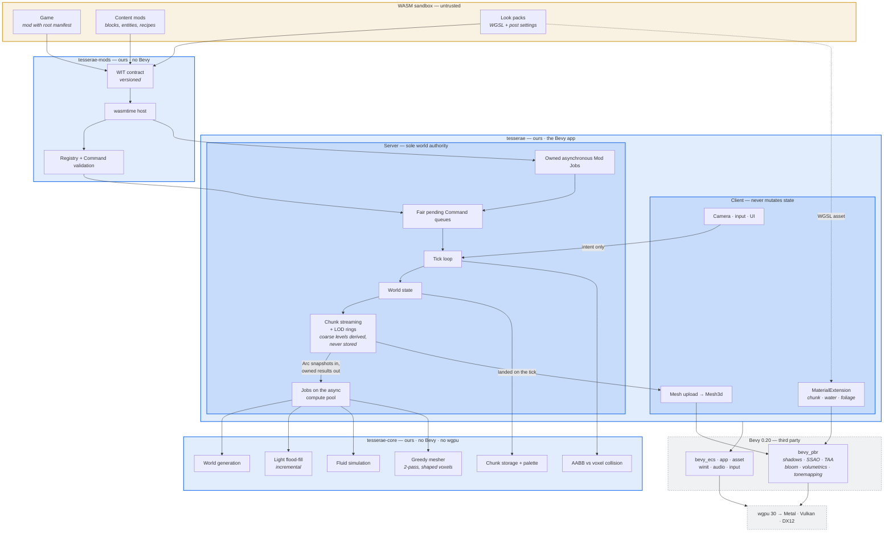

# Architecture

Three crates. The boundary that matters: `tesserae-core` has no Bevy and no
wgpu, so every expensive algorithm is testable and benchmarkable headlessly.



## Where everything sits

Orange is untrusted and sandboxed. Blue is ours. Dashed grey is third party.

| Question                      | Answer                                                                                                                                                          |
| ----------------------------- | --------------------------------------------------------------------------------------------------------------------------------------------------------------- |
| **Where is the engine?**      | All three crates. `tesserae-core` + `tesserae-mods` + `tesserae` _is_ the engine.                                                                               |
| **Where is the game?**        | Outside the repo. A Game is a WASM Mod with a root manifest — orange box, top. One loader for Games and Mods both.                                              |
| **Where is Bevy?**            | Dashed grey, bottom. Only `tesserae` touches it: ECS, app, assets, windowing, input, audio, and `bevy_pbr` for all lighting.                                    |
| **Where is our custom code?** | Blue. `tesserae-core` holds every expensive algorithm with no edge to Bevy or wgpu — that is what makes it benchmarkable. `tesserae` is thin glue.              |
| **Where is the renderer?**    | There isn't one. `bevy_pbr` rasterizes; we supply meshes and `MaterialExtension` WGSL. The decision that saves 12–24 months.                                    |
| **How do Mods work?**         | WASM → WIT contract → asynchronous Wasmtime call → validation → Server-owned **batched** queue → Server tick. Never a direct call into core.                    |
| **How do Look packs work?**   | WASM cannot put code on the GPU. The pack ships WGSL as an _asset_ and registers it by handle; the host compiles it into a `MaterialExtension`. Hot-reloadable. |

## Mechanics are the engine's, content is the Game's

The engine owns how things behave; a Mod's Declaration says which Materials
behave that way, and with what numbers. The engine has no lava, wood or mud;
those are the demo Game's. Water is the one exception: it is a built-in Material
with a built-in fluid row, because generated lakes and a World with no Game need
it.

| Behaviour             | The engine decides                                                      | Data that switches it on, and who declares it                    |
| --------------------- | ----------------------------------------------------------------------- | ---------------------------------------------------------------- |
| A fluid flows         | Spreading, falling, receding and waterlogging, in metres and seconds    | A fluid row: water's is built in, a Mod declares any other       |
| Water puts out fire   | How touching fuel wets it, puts its fire out and keeps it from igniting | `extinguishes` on the fluid row; water's is built in and set     |
| Two fluids react      | How a Contact is found and applied whole or not at all                  | A reaction row, from a Mod: the demo's lava and water make stone |
| Heat sets fuel alight | Exposure through open space, ignition delay, burning and its residue    | A fluid's or a fuel's heat and a combustion row, from a Mod      |

So without a Game, water flows and puts out fire, and nothing else burns or
reacts. See [ADR-0013](adr/0013-fluid-and-fire-live-beside-the-voxel.md) and
[ADR-0012](adr/0012-mods-declare-once-and-command-in-batches.md).

## The three invariants this diagram exists to protect

Each of these is a mistake that will not look wrong in review.

1. **No arrow from Client to World state.** Only intent.
   ([ADR-0002](adr/0002-client-server-from-day-one.md))
2. **No arrow from Mods to core.** Only the batched queue.
   ([ADR-0001](adr/0001-wasm-mod-boundary.md))
3. **No arrow from core to Bevy or wgpu.** Ever.

## Layout

`▸ step N` refers to the build order in [DESIGN.md](../DESIGN.md).

```
tesserae/
├── CONTEXT.md                  glossary — the only names used anywhere
├── DESIGN.md                   decisions, build order, open items
├── Cargo.toml                  workspace
├── docs/
│   ├── architecture.md         this file
│   ├── positioning.md          vs Minecraft/Luanti — internal, not README
│   └── adr/                    0001 wasm · 0002 client-server · 0003 voxel size
│                               0004 demo game · 0005 asset root
│                               0006 shapes are table data
│                               0007 streaming jobs · 0008 player pose
│                               0009 materials are table data
│                               0010 connections are derived
│                               0011 coarse LOD levels are derived
│                               0012 Mods declare once, command in batches
│                               0013 fluid and fire beside the Voxel
│                               0014 bounded logical steps
├── crates/
│   ├── tesserae-core/          NO Bevy, NO wgpu — headless + benchmarkable
│   │   ├── src/
│   │   │   ├── voxel.rs        Voxel = material | shape | orientation       ▸ 1
│   │   │   ├── chunk.rs        palette-compressed 32³ storage               ▸ 1
│   │   │   ├── mesh.rs         mesher: pass 1 cubes, pass 2 shapes        ▸ 1, 5
│   │   │   ├── noise.rs        value noise 2D and 3D, and a range bound     ▸ 3
│   │   │   ├── worldgen.rs     seed + position → Chunk, tuned in metres     ▸ 3
│   │   │   ├── light.rs        incremental flood-fill                       ▸ 4
│   │   │   ├── shape.rs        Shape table, Orientation; derived geometry   ▸ 5
│   │   │   ├── lod.rs          downsample, and the covered-sky coarse light ▸ 6
│   │   │   ├── fluid.rs        fluid table, in metres and metres per second ▸ 8
│   │   │   ├── flow.rs         sources, flow and recession: the kernel      ▸ 8
│   │   │   ├── occupants.rs    fluid and fire beside the Voxel, one reading ▸ 8
│   │   │   ├── agenda.rs       bounded wakes; overflow rescans each Chunk  ▸ 8
│   │   │   ├── reaction.rs     fluid contact rules, canonical, as data      ▸ 8
│   │   │   ├── combustion.rs   heat, fuel and residue, as data              ▸ 8
│   │   │   ├── fire.rs         exposure, ignition, burning and residue      ▸ 8
│   │   │   └── collide.rs      AABB sweep and ray vs grid, in metres        ▸ 5
│   │   └── benches/        criterion — meshing.rs gates step 1          ▸ 1
│   │                       lod.rs: downsample, coarse Chunk, mesh, light  ▸ 6
│   │                       fluids.rs: flow, waterlogging, fire, rescans  ▸ 8
│   ├── tesserae-mods/          NO Bevy, NO wgpu — sandbox + validation     ▸ 7
│   │   ├── wit/0.1/            tesserae:mods@0.1.0, closed, world mod
│   │   ├── wit/0.2/            tesserae:mods@0.2.0: fluids, sources, fire  ▸ 8
│   │   ├── src/                loader, Trust, Registry, async calls, limits
│   │   │   ├── adapt.rs        the 0.1 line carried to 0.2 and back        ▸ 8
│   │   │   └── command.rs      pure batch validation, VoxelBox + BoxCursor
│   │   ├── tests/guests/       independent WASI sandbox fixtures
│   │   └── benches/            host crossings + native validation
│   └── tesserae/               the Bevy app
│       └── src/
│           ├── world.rs        Voxel size, seed, the Chunk lattice          ▸ 2
│           ├── server/         the sole authority over World state         ▸ 3
│           │   ├── world_state.rs  Chunk store — mutators Server-private    ▸ 3
│           │   ├── streaming.rs    rings, dispatch and landing              ▸ 3
│           │   ├── lod.rs          coarse levels: derived Chunks, LodStore  ▸ 6
│           │   ├── lod_rings.rs    one level's shells, with a hole inside   ▸ 6
│           │   ├── jobs.rs         jobs on the async compute pool           ▸ 3
│           │   ├── mods.rs         Mod Jobs, fair queues and tick drain      ▸ 7
│           │   ├── fluids.rs       flow on workers, one step at a time      ▸ 8
│           │   └── edit.rs         the Voxel-edit path, queued intents      ▸ 5
│           ├── client/         camera, input, UI, mesh upload               ▸ 2
│           │   ├── chunk_view.rs   one entity per Chunk the Server sent     ▸ 3
│           │   └── edit.rs         place/break intents, hotbar, crosshair   ▸ 5
│           └── render/         chunk material, distance fog, look packs   ▸ 2, 9
│               ├── chunk_material.rs MaterialExtension and its WESL         ▸ 2
│               └── fog.rs            live FogSettings → one DistanceFog     ▸ 9
├── games/demo/                 MIT WASI guest, only the WIT contract       ▸ 7
├── assets/                     CC0 placeholder textures
├── LICENSE                     BSL 1.1 — blocked on the Change License check
└── USE-GRANT.md                the most important file in the repo
```
