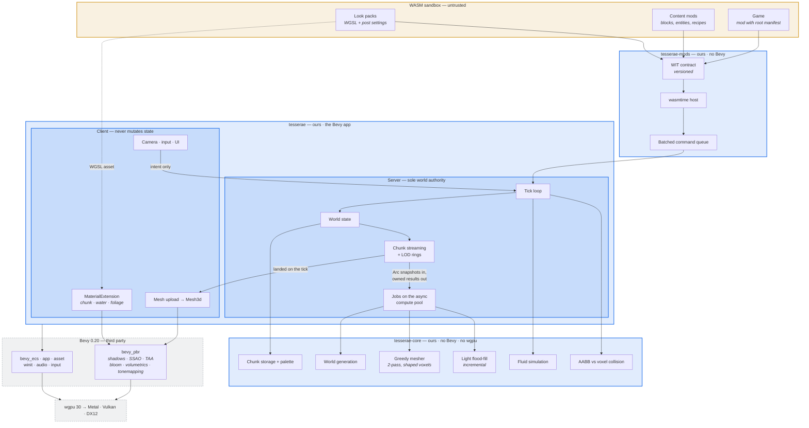

# Architecture

Three crates. The boundary that matters: `tesserae-core` has no Bevy and no
wgpu, so every expensive algorithm is testable and benchmarkable headlessly.



## Where everything sits

Orange is untrusted and sandboxed. Blue is ours. Dashed grey is third party.

| Question                      | Answer                                                                                                                                                          |
| ----------------------------- | --------------------------------------------------------------------------------------------------------------------------------------------------------------- |
| **Where is the engine?**      | All three crates. `tesserae-core` + `tesserae-mods` + `tesserae` _is_ the engine.                                                                               |
| **Where is the game?**        | Outside the repo. A Game is a WASM Mod with a root manifest — orange box, top. One loader for Games and Mods both.                                              |
| **Where is Bevy?**            | Dashed grey, bottom. Only `tesserae` touches it: ECS, app, assets, windowing, input, audio, and `bevy_pbr` for all lighting.                                    |
| **Where is our custom code?** | Blue. `tesserae-core` holds every expensive algorithm with no edge to Bevy or wgpu — that is what makes it benchmarkable. `tesserae` is thin glue.              |
| **Where is the renderer?**    | There isn't one. `bevy_pbr` rasterizes; we supply meshes and `MaterialExtension` WGSL. The decision that saves 12–24 months.                                    |
| **How do Mods work?**         | WASM → WIT contract → wasmtime host → **batched** command queue → Server tick. Never a direct call into core.                                                   |
| **How do Look packs work?**   | WASM cannot put code on the GPU. The pack ships WGSL as an _asset_ and registers it by handle; the host compiles it into a `MaterialExtension`. Hot-reloadable. |

## The three invariants this diagram exists to protect

Each of these is a mistake that will not look wrong in review.

1. **No arrow from Client to World state.** Only intent.
   ([ADR-0002](adr/0002-client-server-from-day-one.md))
2. **No arrow from Mods to core.** Only the batched queue.
   ([ADR-0001](adr/0001-wasm-mod-boundary.md))
3. **No arrow from core to Bevy or wgpu.** Ever.

## Layout

`▸ step N` refers to the build order in [DESIGN.md](../DESIGN.md).

```
tesserae/
├── CONTEXT.md                  glossary — the only names used anywhere
├── DESIGN.md                   decisions, build order, open items
├── Cargo.toml                  workspace
├── docs/
│   ├── architecture.md         this file
│   ├── positioning.md          vs Minecraft/Luanti — internal, not README
│   └── adr/                    0001 wasm · 0002 client-server · 0003 voxel size
│                               0004 demo game · 0005 asset root
│                               0006 shapes are table data
│                               0009 materials are table data
├── crates/
│   ├── tesserae-core/          NO Bevy, NO wgpu — headless + benchmarkable
│   │   ├── src/
│   │   │   ├── voxel.rs        Voxel = material | shape | orientation       ▸ 1
│   │   │   ├── chunk.rs        palette-compressed 32³ storage               ▸ 1
│   │   │   ├── mesh.rs         mesher: pass 1 cubes, pass 2 shapes        ▸ 1, 5
│   │   │   ├── noise.rs        value noise 2D and 3D, and a range bound     ▸ 3
│   │   │   ├── worldgen.rs     seed + position → Chunk, tuned in metres     ▸ 3
│   │   │   ├── light.rs        incremental flood-fill                       ▸ 4
│   │   │   ├── shape.rs        Shape table, Orientation; derived geometry   ▸ 5
│   │   │   ├── lod.rs          2×2×2 dominant-material downsample           ▸ 6
│   │   │   ├── fluid.rs        cellular automaton                           ▸ 8
│   │   │   └── collide.rs      AABB sweep and ray vs grid, in metres        ▸ 5
│   │   └── benches/meshing.rs  criterion — the number that gates step 1     ▸ 1
│   ├── tesserae-mods/          NO Bevy — wasmtime host, WIT, command queue  ▸ 7
│   │   └── wit/                the versioned contract
│   └── tesserae/               the Bevy app
│       └── src/
│           ├── world.rs        Voxel size, seed, the Chunk lattice          ▸ 2
│           ├── server/         the sole authority over World state         ▸ 3
│           │   ├── world_state.rs  Chunk store — mutators Server-private    ▸ 3
│           │   ├── streaming.rs    rings, dispatch and landing              ▸ 3
│           │   ├── jobs.rs         jobs on the async compute pool           ▸ 3
│           │   └── edit.rs         the Voxel-edit path, queued intents      ▸ 5
│           ├── client/         camera, input, UI, mesh upload               ▸ 2
│           │   ├── chunk_view.rs   one entity per Chunk the Server sent     ▸ 3
│           │   └── edit.rs         place/break intents, hotbar, crosshair   ▸ 5
│           └── render/         MaterialExtension + look-pack API            ▸ 9
├── assets/                     CC0 placeholder textures
├── LICENSE                     BSL 1.1 — blocked on the Change License check
└── USE-GRANT.md                the most important file in the repo
```
