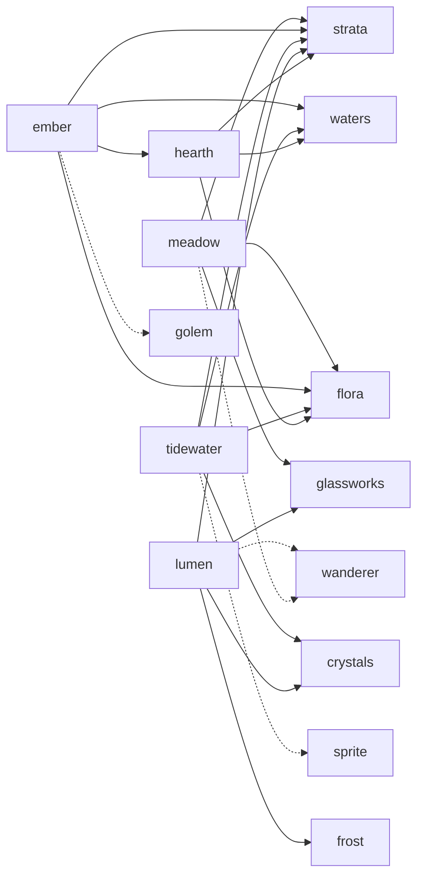

# Demo Games and shared Mods

The repository ships five Games and twelve Mods. `terra` is the one
self-contained Rust Game, the template
[ADR-0004](adr/0004-demo-game-in-repo-real-game-out.md) describes. The other
four Games are small Rust components that declare a World and one behaviour, and
take every Material, fluid and Shape from the data Mods in [`mods/`](../mods/)
they depend on. That split is the pattern worth copying: code for behaviour,
data for content, shared across Games.

## Games

All Games are MIT licensed and sit in `games/<id>/`. Only a Game declares
`world`, `view` and `tools`.

| Game                             | Behaviour (Rust)                         | Depends on                                              | Shows                                                                                                         |
| -------------------------------- | ---------------------------------------- | ------------------------------------------------------- | ------------------------------------------------------------------------------------------------------------- |
| [terra](../games/terra/)         | Everything; self-contained               | -                                                       | A Game that declares its own content, fluids, fire, a tool, Biomes and an ore                                 |
| [meadow](../games/meadow/)       | Builds a glade, three trees and a gazebo | strata, flora, glassworks (suggests wanderer)           | A Game whose only Material is its food; a Shape from one Mod with a Material of another; Biomes from `strata` |
| [ember](../games/ember/)         | Lava vents erupt on a timer              | strata, waters, flora, hearth (suggests golem)          | Fluid, reaction and fire rules that live in Mods; Biomes that tune the caves                                  |
| [tidewater](../games/tidewater/) | The sea level rises and falls slowly     | strata, waters, flora, crystals (suggests sprite)       | Sea level, caves, smoothing, Biomes and a gem ore; fluid Commands from `tick`                                 |
| [lumen](../games/lumen/)         | Lanterns light up in sequence            | strata, glassworks, frost, crystals (suggests wanderer) | Blended glass, emission and Shapes; timed placement from `tick`; Biomes with a snow court and a gem ore       |

## Food

Every Game has a food that lies in its World: a solid Material whose Item has a
food value, scattered by world generation as a surface feature of the Biomes
whose surface suits it. Break one to pick it up and press G to eat it.

| Game      | Food                | Hunger | On the surface of                                      | Spacing |
| --------- | ------------------- | ------ | ------------------------------------------------------ | ------- |
| terra     | `terra:melon`       | 6      | `temperate` (`terra:grass`)                            | 16 m    |
| meadow    | `meadow:pumpkin`    | 8      | `meadow` (`strata:turf`), `heath` (`strata:soil`)      | 20 m    |
| ember     | `ember:pepper`      | 4      | `ash_flats` (`hearth:ash`), `highland` (`flora:grass`) | 16 m    |
| tidewater | `tidewater:coconut` | 6      | `lagoon` (`strata:turf`), `salt_flats` (`strata:sand`) | 16 m    |
| lumen     | `lumen:glowberry`   | 5      | `garden` (`strata:turf`), `frost_court` (`frost:snow`) | 20 m    |

## Mods

All Mods are data only (`declaration = "content.toml"`, contract 0.3), MIT
licensed, with original PNG textures generated by
[`scripts/generate-mod-art`](../scripts/generate-mod-art) and so free of any
third-party source. They declare content only.

| Mod                       | Content                                                   | Depends on            | Used by                          |
| ------------------------- | --------------------------------------------------------- | --------------------- | -------------------------------- |
| [strata](strata/)         | Stone, basalt, clay, sand, soil, turf                     | -                     | all four Games, hearth           |
| [waters](waters/)         | Water fluid, steam, obsidian                              | -                     | ember, tidewater, hearth         |
| [flora](flora/)           | Wood, leaves, grass, kelp                                 | -                     | meadow, ember, tidewater, hearth |
| [hearth](hearth/)         | Lava, ash; lava and water reactions; wood and leaves burn | strata, waters, flora | ember, bog                       |
| [glassworks](glassworks/) | Glass, frosted glass, lantern; slab, stair, fence         | -                     | meadow, lumen                    |
| [timber](timber/)         | Planks, thatch; beam and panel Shapes                     | -                     | -                                |
| [brickwork](brickwork/)   | Brick, cobble, tile; connecting wall Shape                | -                     | bog                              |
| [lamps](lamps/)           | Glowstone, amberlight, moonlight; bulb Shape              | -                     | -                                |
| [wool](wool/)             | Six coloured cloths; carpet Shape                         | -                     | -                                |
| [frost](frost/)           | Ice, snow, packed ice, slush fluid; snow layer Shape      | -                     | lumen                            |
| [crystals](crystals/)     | Amethyst, citrine, aquamarine; cluster Shape              | -                     | tidewater, lumen                 |
| [bog](bog/)               | Peat, mud and tar fluids; lava reactions; peat burns      | hearth, brickwork     | -                                |
| [wanderer](wanderer/)     | Character: a traveller, 1.8 m                             | -                     | meadow, lumen                    |
| [golem](golem/)           | Character: a slow stone figure, 2.16 m                    | -                     | ember                            |
| [sprite](sprite/)         | Character: a small quick figure, 1.44 m                   | -                     | tidewater                        |

The lava and water reactions are in `hearth` rather than `waters`, because they
need both fluids and `waters` has to work in a World with no lava, such as
tidewater's.

## Dependency graph



Game-to-Mod references in a Declaration are always `<mod id>:<name>`, for
example `strata:turf` or `glassworks:fence`; a Game and a Mod resolve each
other's names whatever order they were declared in.

## Validate

These commands run from the repository root. `tesserae` is the Engine binary;
from a checkout use `cargo run --release --` in its place.

```sh
for mod in mods/*/; do tesserae validate "$mod" --mods mods; done
```

The glob ends in `/` so it names the Mod folders and not `mods/README.md`. A
Game is a component, so build it first and grant it Trust for the check:

```sh
./scripts/build-guests
tesserae validate games/ember --mods mods --trust-for-run
```

`--mods mods` supplies the Mods a Game depends on. Validation opens no World.

## Package and run

From a checkout, two scripts do the steps below:

```sh
./scripts/package-demo   # build the Games, package them and every Mod into dist/
./scripts/demo           # run the Engine on dist/ (packages first if it is missing)
```

`package-demo` replaces `dist/games` and `dist/mods` only, so Trust grants in
`dist/trust.json` survive. The steps by hand:

`package` takes one Game at most, so package the Mods once and each Game in turn
into the same folder:

```sh
for mod in mods/*/; do tesserae package "$mod" --out dist --mods mods; done
for game in terra meadow ember tidewater lumen; do
  tesserae package games/$game --mods mods --out dist --trust-for-run
done
cargo run --release -- --mods dist/mods
```

The folder is then `dist/games/<id>/` and `dist/mods/<id>/`. The last command
starts the Engine on it; create a World and choose a Game from the list. The
Engine asks you to trust each build the first time (`--trust-all` skips the
prompt for a script). A World keeps the Game and the Mods it was made with, and
`terra` stays the Game a World with no record opens.

To restart a World as you edit a Game or Mod, see
[Watching a project](data-mods.md#watching-a-project).

## Writing your own

Copy [`mods/glassworks`](../mods/glassworks/) to see a Mod with Shapes, or
[`games/lumen`](../games/lumen/) for the smallest Game that builds from Mods.
The [authoring guide](authoring-guide.md) covers the Declaration schema and the
data and Rust starters; [data Mods](data-mods.md) covers loading, validating and
watching.
